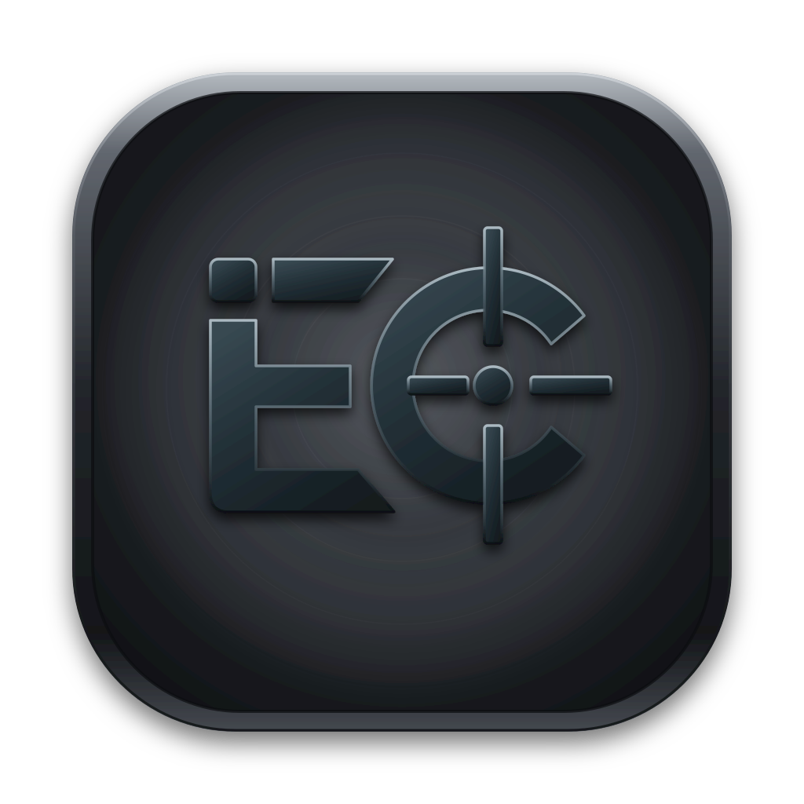

<p align="center">
  
</p>

<h1 align="center">EasyControl</h1>

<p align="center">
  轻量级 macOS 菜单栏窗口控制与抓手滚动工具（原生 Swift / AppKit）
</p>

---

## 功能特性

- **任意位置移动与九宫格缩放窗口**：按住修饰键（默认 `⌃ + ⌘`），在窗口任意区域左键拖动即可 1:1 跟手移动，右键拖动按九宫格方向缩放窗口。
- **左/上边框无阻碍扩缩**：遵循先移位后缩放、再以系统实际接受尺寸校准对侧边缘的策略，解决贴边或受最小尺寸限制时左/上边无法向外拉大或反向漂移的问题。
- **抓手滚动（Grab Scroll）**：按住抓手修饰键（默认 `⌃`）＋左键拖动即可对光标下方视图进行像素级平滑滚动；未拖动时的普通点击会自动回放，不破坏右键/上下文菜单操作。
- **触控板选项**：
  - **双指滚动调整大小**：按住窗口修饰键配合双指滚动快速调整窗口大小。
  - **三指平移拖移窗口**：可自由启用或关闭对触控板三指拖移手势（需系统「辅助功能 → 指针控制 → 触控板选项 → 使用触控板进行拖移（三指拖移）」开启）的窗口移动接管；关闭时不影响正常单指/鼠标拖动。
- **应用级兼容性增强**：针对微信（Qt 视图）、系统设置等 `AXUIElementCopyElementAtPosition` 无法直接返回 `AXWindow` 的应用，自动回溯父节点并结合 `CGWindowListCopyWindowInfo` Z 序精准定位真实窗口。
- **动态权限与逐应用禁用**：打开菜单栏自动刷新辅助功能权限状态与当前前台应用，支持一键按应用禁用/恢复，并支持按住 `⌘` 拖动调整菜单栏图标位置。

## 默认快捷键

| 操作 | 默认手势 / 快捷键 | 说明 |
| --- | --- | --- |
| 移动窗口 | `⌃ + ⌘` + 左键拖动 | 基于初始位置 1:1 绝对坐标异步合并下发，不发飘 |
| 调整窗口大小 | `⌃ + ⌘` + 右键拖动 | 按鼠标在窗口内的九宫格位置决定缩放边/角 |
| 抓手滚动 | `⌃` + 左键拖动 | 超过 3pt 阈值后转为像素滚动 |
| 双指滚动调整大小 | `⌃ + ⌘` + 双指滚动 | 需在「触控板选项」中勾选开启 |
| 三指平移拖移窗口 | `⌃ + ⌘` + 三指拖动 | 可在「触控板选项」中独立开启/关闭 |

所有修饰键均可在菜单栏中自定义为 `⌃`、`⌥`、`⇧`、`⌘` 的任意非空组合。

## 权限与兼容性说明

- 首次运行需在 **系统设置 → 隐私与安全性 → 辅助功能** 中允许 `EasyControl`。
- 若本机同时运行旧版 `Easy Move+Resize` 或 `Hammerspoon`，EasyControl 会自动等待避让，避免重复拦截鼠标事件。
- **macOS 系统已知限制**：部分系统窗口（如「系统设置」）在系统层锁定了固定宽度（仅允许移动位置与上下调整高度），左右拖动扩宽不会改变其宽度。

## 构建与安装

需要 macOS Command Line Tools（`swiftc`、`iconutil`、`codesign`）：

```bash
cd EasyControl
./build.sh
cp -R build/EasyControl.app /Applications/
open /Applications/EasyControl.app
```

## 开源协议与致谢

本项目基于 [MIT License](LICENSE.txt) 开源。窗口九宫格移动缩放交互灵感及部分设计参考自开源项目 [`dmarcotte/easy-move-resize`](https://github.com/dmarcotte/easy-move-resize)。
